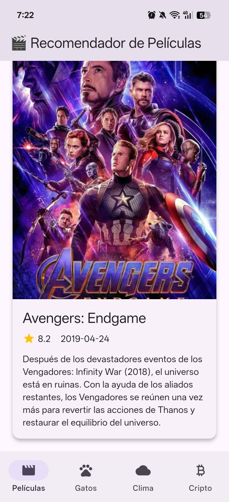
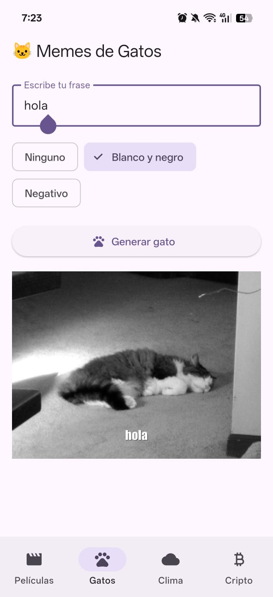
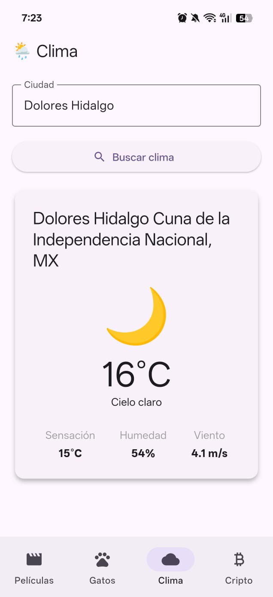
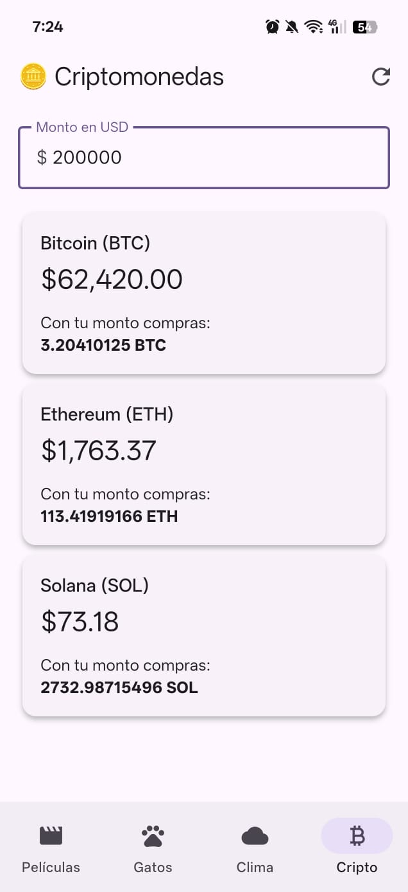

# 🚀 Cuatro Retos Flutter

Aplicación móvil hecha en **Flutter** que reúne **cuatro retos de consumo de APIs** en una sola app, con una barra de navegación inferior para pasar de un reto a otro.

---

## 📱 Los cuatro retos

| # | Pestaña | API | ¿Necesita API key? | ¿Qué hace? |
|---|---------|-----|--------------------|------------|
| 1 | 🎬 Películas | [TMDB](https://www.themoviedb.org/) | Sí (gratuita) | Recomienda una película al azar según tu estado de ánimo, con póster, calificación y sinopsis. |
| 2 | 🐱 Gatos | [Cataas](https://cataas.com/) | No | Genera una imagen de gato con tu frase encima. Incluye filtros de blanco y negro y negativo. |
| 3 | 🌦️ Clima | [OpenWeatherMap](https://openweathermap.org/) | Sí (gratuita) | Muestra el clima actual de la ciudad que escribas: temperatura, sensación térmica, humedad y viento. |
| 4 | 🪙 Cripto | [CoinGecko](https://www.coingecko.com/) | No | Muestra el precio de Bitcoin, Ethereum y Solana en dólares y calcula cuántas fracciones comprarías con el monto en USD que escribas. |

## 📸 Capturas de la app

